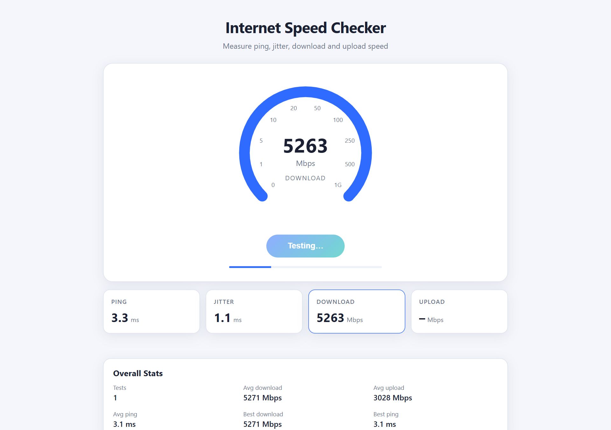
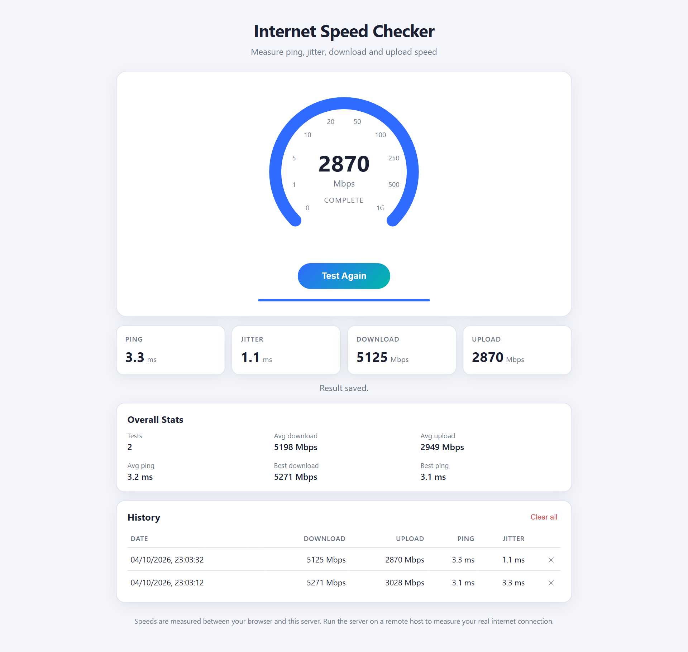
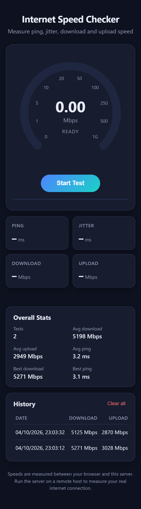

# Internet Speed Checker


Measures **ping, jitter, download and upload speed** in the browser and saves every result to a database.

- **Frontend:** HTML, CSS, vanilla JavaScript (`src/main/resources/static`)
- **Backend:** Java 21 + Spring Boot 3 (REST API)
- **Database:** PostgreSQL (H2 in-memory profile available for quick runs and tests)

## Screenshots

**Test in progress**



**Results, stats and history**



**Mobile (dark mode)**



> Screenshots were taken with the server on `localhost`, which is why the speeds are in the Gbps range.

## How it works

| Step | Browser does | Server endpoint |
|------|--------------|-----------------|
| Ping / jitter | 12 tiny requests, timing each round trip (median = ping, mean change between samples = jitter) | `GET /api/speedtest/ping` |
| Download | 4 parallel streams of random bytes for 10 s; counts bytes received | `GET /api/speedtest/download?size=…` |
| Upload | 3 parallel streams posting 4 MB random blobs for 10 s; counts bytes sent | `POST /api/speedtest/upload` |
| Save | Sends the final numbers | `POST /api/results` |

The first 1.5 s of each download/upload phase is ignored so TCP slow-start doesn't drag the number down.

> **Note:** the speed measured is between your browser and *this server*. On `localhost` you'll see huge numbers (it's your own machine). Deploy it to a remote host (VPS, Render, Railway, etc.) to measure your real internet connection.

## Running

### 1. Create the database (PostgreSQL)

```sql
CREATE DATABASE speedchecker;
```

The `speed_test_results` table is created automatically on startup. See `src/main/resources/schema-reference.sql` for the structure.

### 2. Start the app

Set your PostgreSQL credentials (PowerShell):

```powershell
$env:DB_USERNAME="postgres"
$env:DB_PASSWORD="your-password"
.\mvnw.cmd spring-boot:run
```

Open <http://localhost:8080>.

### Without PostgreSQL (in-memory, data lost on restart)

```powershell
.\mvnw.cmd spring-boot:run "-Dspring-boot.run.profiles=h2"
```

### Tests

```powershell
.\mvnw.cmd test
```

### Build a runnable jar

```powershell
.\mvnw.cmd package
java -jar target\internet-speed-checker-1.0.0.jar
```

No Maven install needed — `mvnw.cmd` downloads it on first use.

## Configuration

| Env var | Default |
|---------|---------|
| `DB_URL` | `jdbc:postgresql://localhost:5432/speedchecker` |
| `DB_USERNAME` | `postgres` |
| `DB_PASSWORD` | `postgres` |
| `PORT` | `8080` |

## REST API

| Method | Path | Description |
|--------|------|-------------|
| GET | `/api/speedtest/ping` | Latency probe |
| GET | `/api/speedtest/download?size=N` | Stream N random bytes (max 200 MB) |
| POST | `/api/speedtest/upload` | Discard body, return `bytesReceived` |
| POST | `/api/results` | Save `{downloadMbps, uploadMbps, pingMs, jitterMs}` |
| GET | `/api/results?limit=20` | Recent results (max 100) |
| GET | `/api/results/stats` | Count, averages, bests |
| DELETE | `/api/results/{id}` | Delete one result |
| DELETE | `/api/results` | Delete all results |

## Project structure

```
src/main/java/com/speedchecker
├── SpeedCheckerApplication.java
├── controller/   SpeedTestController, ResultController, GlobalExceptionHandler
├── service/      ResultService
├── repository/   SpeedTestResultRepository
├── model/        SpeedTestResult (JPA entity)
└── dto/          ResultRequest, StatsResponse
src/main/resources
├── application.properties      (PostgreSQL)
├── application-h2.properties   (in-memory)
└── static/                     index.html, css/style.css, js/app.js
```

## Ideas to extend

- Switch to MySQL: swap the `postgresql` dependency for `mysql-connector-j` and change `DB_URL`.
- Add Flyway migrations instead of `ddl-auto=update`.
- Chart the history (Chart.js) or add user accounts with Spring Security.

## License

This project is licensed under the [MIT License](LICENSE).
